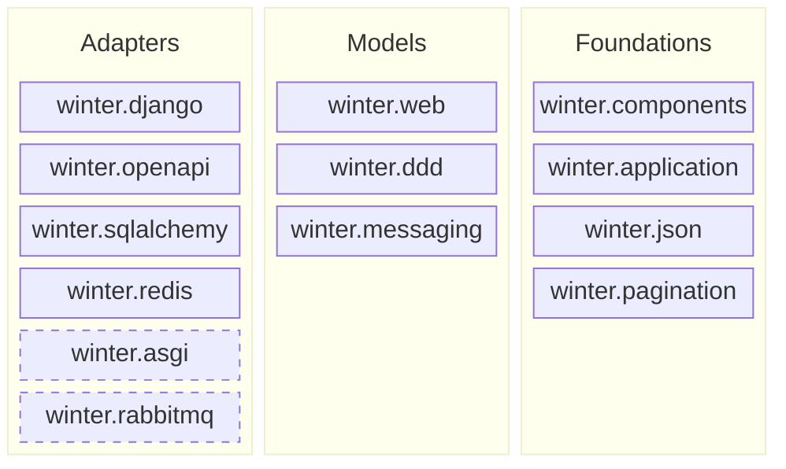

# Architecture

This document describes the **target** structure of Winter: the author's intent. Where the code
differs from it, [Current deviations](#current-deviations) says so. The layer rules are enforced
mechanically, see [Enforcement](#enforcement).

## Target structure

A layer may import only layers to its right. Packages within Adapters and within Models are
independent of each other. Dashed packages are planned and do not exist yet.

| Layer | Rule | Packages |
|---|---|---|
| Adapters | Bind the models to external technologies and standards. Independent of each other. | `django`, `openapi`, `sqlalchemy`, `redis`, `asgi` (planned), `rabbitmq` (planned) |
| Models | Framework-agnostic descriptions of what an application does. Independent of each other. | `web` (HTTP), `ddd` (domain: aggregates, repositories, domain events), `messaging` (events) |
| Foundations | Shared vocabulary and mechanisms. Unaware of the layers above. May use each other. | `components` (declarative metadata), `application` (scope, injector, discovery), `json`, `pagination` |

A package belongs to Foundations when it knows nothing about models or adapters and is used by
at least two of them.

## Principles

1. **`winter` is a PEP 420 namespace package.** There is no `winter/__init__.py`. Each
   subpackage can later ship as its own distribution from its own repository without any
   import path changing.
2. **Framework behaviour is never process-global.** Every behavioural registry (exception
   handlers, interceptors, argument resolvers, throttling configuration, OpenAPI inspectors)
   belongs to an `Application` instance, so two applications can live in one process.
   Declarative metadata about types (component annotations, JSON encoders for a type) may be
   global, like the classes it describes.
3. **Glue between models, or between adapters, is application code.** Mapping a domain
   `NotFoundException` to HTTP 404, or mounting the Swagger UI route, is done by the
   application that composes the pieces, not by the framework.
4. **Adapters are named after the technology they bind** (`django`, `sqlalchemy`, `redis`),
   models and foundations after the concept they describe.

## Current deviations

- **Framework behaviour is still process-global.** `winter.application.get_injector` is a
  service locator, and the behavioural registries of `winter.web` and `winter.openapi` are module
  singletons. `tests/test_application_scope.py` states the intended behaviour and is marked
  `xfail` until an `Application` instance owns that state.
- **`winter.asgi` and `winter.rabbitmq` do not exist yet.** HTTP is served through `winter.django`
  only, and `winter.messaging` has no transport adapter.
- **All dependencies are mandatory.** Django, SQLAlchemy, Redis and pydantic are installed with
  `winter` even when their adapter is not used; extras are the intended shape.
- **`winter.openapi` recognises Django's `HttpResponseBase`** as a raw response type when Django
  is importable, so that API methods returning a Django response get no response schema.
- **Deprecated import paths** (`winter.core`, `winter.data`, `winter_ddd`, `winter_django`,
  `winter_openapi`, `winter_sqlalchemy`, the Redis names in `winter.web.throttling`,
  `winter.web.routing.reverse`) are aliases implemented in `winter/_deprecation.py` and listed in
  `ignore_imports`. They are removed in the next major version.

## Enforcement

- **import-linter** (`lint-imports`, configured in `pyproject.toml`) checks the layer rules.
  `ignore_imports` lists the known violations, each with the reason; nothing new may be added.
- **North-star test** `tests/test_application_scope.py` is marked `xfail(strict=True)`. It
  creates two `Application` instances with different exception handlers and asserts they do
  not see each other. `strict` forces the marker to be removed the moment it passes.
- **This document** describes intent and is updated when the intent changes, not when the code
  moves. Deviations are listed above while they exist.
