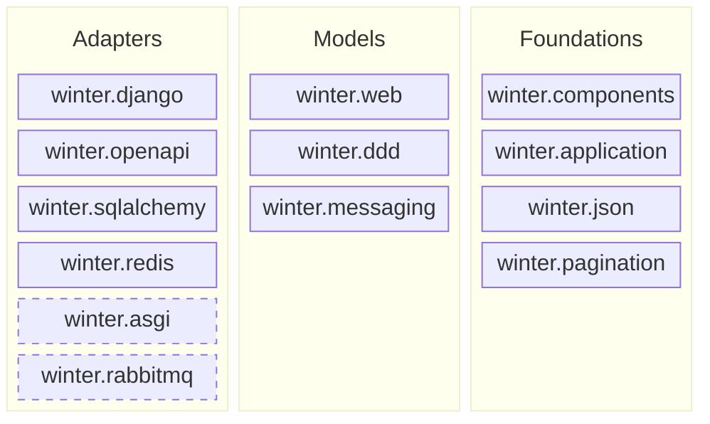

# Architecture

This document describes the **target** structure of Winter: the author's intent, not the
current state of the code. The gap between the two is tracked mechanically, see
[Enforcement](#enforcement). Package names below are the target names; the mapping from the
current layout is in [Current to target](#current-to-target).

## Target structure

A layer may import only layers to its right. Packages within Adapters and within Models are
independent of each other. Dashed packages are planned and do not exist yet.

| Layer | Rule | Packages |
|---|---|---|
| Adapters | Bind the models to external technologies and standards. Independent of each other. | `django`, `openapi`, `sqlalchemy`, `redis`, `asgi` (planned), `rabbitmq` (planned) |
| Models | Framework-agnostic descriptions of what an application does. Independent of each other. | `web` (HTTP), `ddd` (domain: aggregates, repositories, domain events), `messaging` (events) |
| Foundations | Shared vocabulary and mechanisms. Unaware of the layers above. May use each other. | `components` (declarative metadata), `application` (scope, injector, discovery), `json`, `pagination` |

A package belongs to Foundations when it knows nothing about models or adapters and is used by
at least two of them.

## Principles

1. **`winter` is a PEP 420 namespace package.** There is no `winter/__init__.py`. Each
   subpackage can later ship as its own distribution from its own repository without any
   import path changing.
2. **Framework behaviour is never process-global.** Every behavioural registry (exception
   handlers, interceptors, argument resolvers, throttling configuration, OpenAPI inspectors)
   belongs to an `Application` instance, so two applications can live in one process.
   Declarative metadata about types (component annotations, JSON encoders for a type) may be
   global, like the classes it describes.
3. **Glue between models, or between adapters, is application code.** Mapping a domain
   `NotFoundException` to HTTP 404, or mounting the Swagger UI route, is done by the
   application that composes the pieces, not by the framework.
4. **Adapters are named after the technology they bind** (`django`, `sqlalchemy`, `redis`),
   models and foundations after the concept they describe.

## Current to target

| Current | Target |
|---|---|
| `winter.core` — components, annotations, docstring, typing utils | `winter.components` |
| `winter.core` — injection, application, module discovery | `winter.application` |
| `winter.core.json` | `winter.json`; Django `Promise` handling moves to `winter.django` |
| `winter.data.pagination` | `winter.pagination` |
| `winter.data` — `CRUDRepository`, `NotFoundException` | `winter.ddd` |
| `winter.web` except Django-specific code and the Redis client | `winter.web` |
| `winter.web.throttling` Redis client | `winter.redis.throttling`; `winter.web` keeps a storage protocol |
| `winter_django` plus Django-specific code from `winter.web` | `winter.django` |
| `winter_openapi` | `winter.openapi` |
| `winter_sqlalchemy` | `winter.sqlalchemy` |
| `winter_ddd` | `winter.ddd` |

Old import paths stay for one major version as shims that re-export and emit
`DeprecationWarning`.

## Migration stages

Each stage is a separate pull request and releasable on its own.

1. Intent in the repository: this document, import-linter contracts, the north-star test.
2. Foundations: split `winter.core`; move pagination out of `winter.data`. Shims. Minor release.
3. Dissolve `winter.data` into `winter.ddd`. Shims. Minor release.
4. Adapters under the `winter.` namespace. Shims. Minor release.
5. Redis out of `winter.web`: storage protocol in `web`, implementation in `winter.redis`.
6. Django out of `winter.web` into `winter.django`. Several pull requests; the only stage
   that changes the public API of `winter.web`.
7. Major release: remove `winter/__init__.py`, `winter` becomes a namespace package.
   A codemod for consumers ships with the release. Shims live until the next major.
8. Application scope: behavioural registries move into the `Application` instance.
   Runs alongside stages 5 and 6 and finishes with the ASGI adapter.

Tests move together with the code they test, package by package, into `tests/<package>/`.

## Enforcement

- **import-linter** (`lint-imports`, configured in `pyproject.toml`) checks the layer rules
  against the current package names. Known violations are listed in `ignore_imports` of each
  contract. That list is the measured distance to the target: every stage above shortens it,
  and nothing new may be added to it.
- **North-star test** `tests/test_application_scope.py` is marked `xfail(strict=True)`. It
  creates two `Application` instances with different exception handlers and asserts they do
  not see each other. It turns green when principle 2 is implemented, and `strict` forces the
  marker to be removed at that moment.
- **Diagram and this document** describe intent and are updated when the intent changes, not
  when the code moves.
