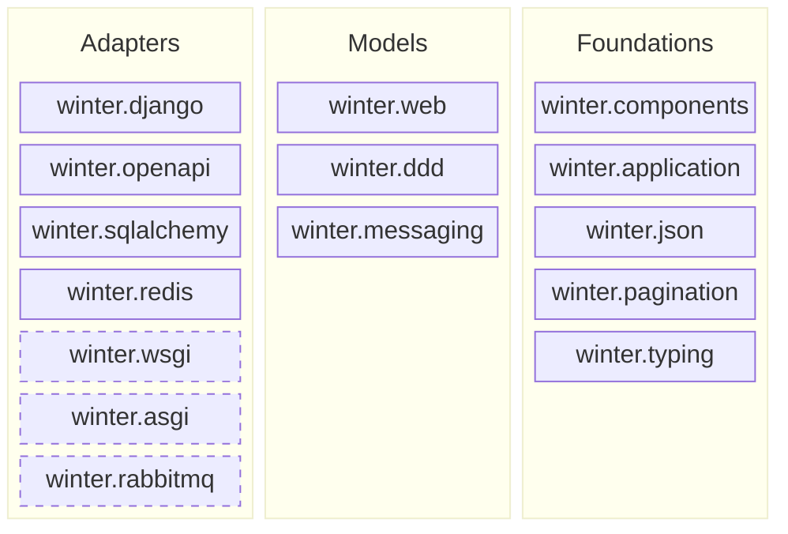

# Architecture

This document describes the **target** structure of Winter: the author's intent. Where the code
differs from it, [Current deviations](#current-deviations) says so. The layer rules are enforced
mechanically, see [Enforcement](#enforcement).

## Target structure

A layer may import only layers to its right. Packages within Adapters and within Models are
independent of each other. Dashed packages are planned and do not exist yet.

| Layer | Rule | Packages |
|---|---|---|
| Adapters | Bind the models to external technologies and standards. Independent of each other. | `django`, `openapi`, `sqlalchemy`, `redis`, `wsgi` (planned), `asgi` (planned), `rabbitmq` (planned) |
| Models | Framework-agnostic descriptions of what an application does. Independent of each other. | `web` (HTTP), `ddd` (domain: aggregates, repositories, domain events), `messaging` (events) |
| Foundations | Shared vocabulary and mechanisms. Unaware of the layers above. May use each other. | `components` (declarative metadata), `application` (discovery of definitions), `json`, `pagination`, `typing` (what the stdlib `typing` lacks) |

A package belongs to Foundations when it knows nothing about models or adapters and is used by
at least two of them.

## Principles

1. **`winter` is a PEP 420 namespace package.** There is no `winter/__init__.py`. Each
   subpackage can later ship as its own distribution from its own repository without any
   import path changing.
2. **Framework behaviour is never process-global.** Every behavioural registry (exception
   handlers, interceptors, throttling configuration) belongs to the application object an adapter
   builds from, such as `winter.web.WebApplication`, and the values that its methods receive come
   from its injector, so two applications can live in one process. What belongs to an adapter, such
   as the response types of its framework, the adapter passes to `winter.web.handle_request` itself.
   Declarative metadata about types (component annotations, JSON encoders and OpenAPI type
   inspectors for a type) may be global, like the classes it describes.
3. **Glue between models, or between adapters, is application code.** Mapping a domain
   `NotFoundException` to HTTP 404, or mounting the Swagger UI route, is done by the
   application that composes the pieces, not by the framework.
4. **Adapters are named after the technology they bind** (`django`, `sqlalchemy`, `redis`),
   models and foundations after the concept they describe.

## Current deviations

- **`winter.wsgi`, `winter.asgi` and `winter.rabbitmq` do not exist yet.** HTTP is served through
  `winter.django` only, and `winter.messaging` has no transport adapter.
- **All dependencies are mandatory.** Django, SQLAlchemy, Redis and pydantic are installed with
  `winter` even when their adapter is not used; extras are the intended shape.
- **`winter.openapi` recognises Django's `HttpResponseBase`** as a raw response type when Django
  is importable, so that API methods returning a Django response get no response schema.

## Enforcement

- **import-linter** (`lint-imports`, configured in `pyproject.toml`) checks the layer rules.
  There are no `ignore_imports`, and none may be added.
- **Isolation test** `tests/test_application_scope.py` builds two applications in one process
  and asserts that the handler of a `@problem` exception of one does not handle that exception in
  the other, that the arguments of an API method come from the injector of the application that
  serves it, that an interceptor of one does not run in the other, and that each counts throttled
  requests in the storage of its own injector. Each registry that moves into
  the application adds its case there.
- **This document** describes intent and is updated when the intent changes, not when the code
  moves. Deviations are listed above while they exist.
